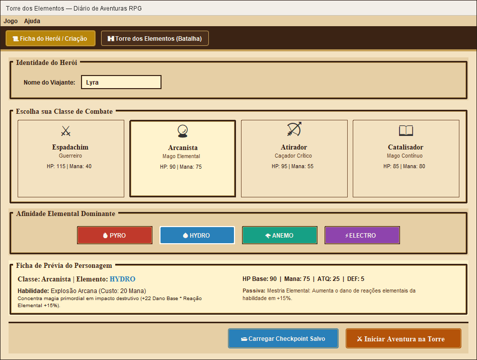
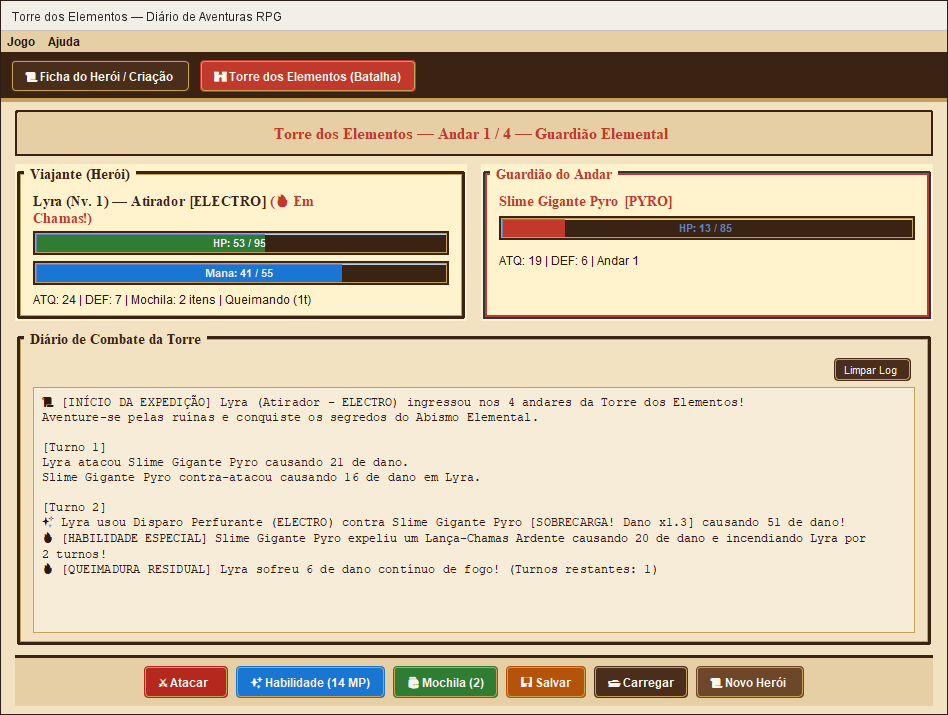
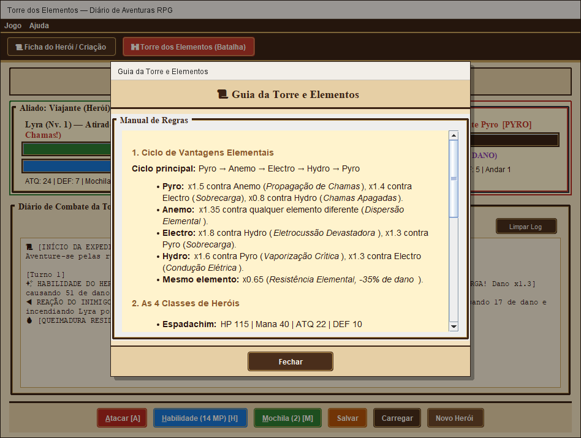
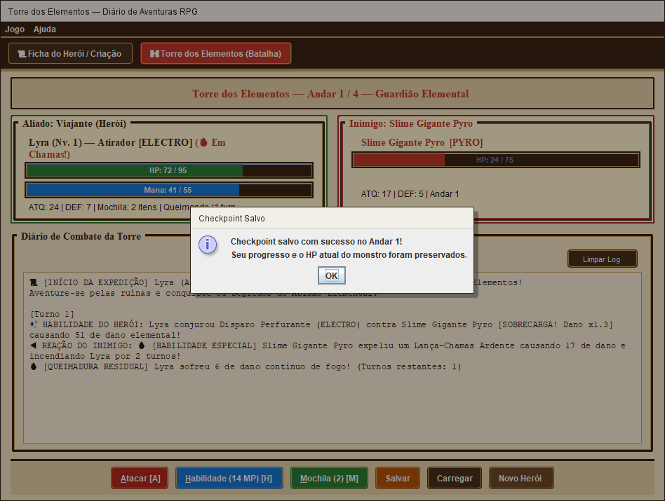

# Manual do Usuário — Torre dos Elementos

**Disciplina:** Programação Orientada a Objetos (POO) — Sistemas de Informação (UFU)  
**Integrantes:** Celina, Isabela Dantas e Isabela Rocha  
**Tecnologias:** Java SE e Java Swing (`javax.swing`)

---

## 1. Apresentação

**Torre dos Elementos** é um RPG de combate por turnos em Java com interface gráfica em Java Swing. O jogador cria um herói, escolhe uma classe de combate e uma afinidade elemental, e enfrenta os guardiões dos 4 andares da Torre até derrotar o chefe final.

Durante a jornada, cada vitória de andar faz o herói subir de nível e desencadeia eventos nas ruínas, como baús de tesouro, fontes místicas, altares permanentes e emboscadas de mímicos.

---

## 2. Requisitos do Sistema

- **Java Development Kit (JDK):** versão 11 ou superior (testado com Eclipse Temurin JDK 21).
- **Bibliotecas:** apenas a biblioteca padrão do Java (`java.*` e `javax.swing.*`), sem necessidade de Maven, Gradle ou pacotes externos.
- **Sistema operacional:** Windows, Linux ou macOS com suporte gráfico (ambiente desktop para Java Swing).

---

## 3. Como Compilar e Executar

Abra o terminal na raiz do projeto (`rpg-poo-java/`) e execute os comandos correspondentes ao seu sistema operacional.

### Windows (PowerShell)

```powershell
New-Item -ItemType Directory -Path bin -Force | Out-Null
$arquivos = Get-ChildItem -Path src -Recurse -Filter "*.java" | ForEach-Object { $_.FullName }
javac -encoding UTF-8 -d bin $arquivos
java -cp bin telas.TelaJogo
```

### Linux ou macOS (Bash / Zsh)

```bash
mkdir -p bin
javac -encoding UTF-8 -d bin $(find src -name "*.java")
java -cp bin telas.TelaJogo
```

> **Observação:** o diretório `bin/` e o arquivo de salvamento `save_jogo.txt` são ignorados pelo `.gitignore` para manter o repositório limpo.

---

## 4. Como Jogar

### 4.1. Criação de Personagem

Ao abrir o programa, a aba **Ficha do Herói / Criação** é exibida para configurar seu personagem:



1. **Nome do Viajante:** digite um nome válido no campo de texto (não deixe em branco e evite o caractere `;`).
2. **Escolha sua Classe de Combate:** clique em um dos 4 cards para definir o estilo do herói.
3. **Afinidade Elemental Dominante:** selecione entre **PYRO**, **HYDRO**, **ANEMO** ou **ELECTRO**.
4. **Ficha de Prévia do Personagem:** confira os atributos iniciais, a habilidade especial e a passiva antes de clicar em **Iniciar Aventura na Torre**.

#### Resumo das Classes

| Classe | HP Base | Mana Base | Ataque | Defesa | Habilidade Especial (Custo) | Passiva |
| --- | :---: | :---: | :---: | :---: | --- | --- |
| **Espadachim** | 115 | 40 | 22 | 10 | *Lâmina Elemental* (15 MP) | 16% de chance de esquiva |
| **Arcanista** | 90 | 75 | 25 | 5 | *Explosão Arcana* (20 MP) | +15% de dano nas reações elementais da habilidade |
| **Atirador** | 95 | 55 | 24 | 7 | *Disparo Perfurante* (14 MP) | 28% de chance de acerto crítico (150% de dano) |
| **Catalisador** | 85 | 80 | 23 | 5 | *Ressonância Suprema* (22 MP) | Ataques básicos aplicam reação elemental e crítico |

#### Ciclo e Reações Elementais

As habilidades (e os ataques básicos do Catalisador) aplicam multiplicadores conforme o elemento do atacante contra o elemento do defensor:

- **Ciclo principal:** `Pyro -> Anemo -> Electro -> Hydro -> Pyro`
- **Pyro:** `x1.5` contra Anemo (*Propagação de Chamas*), `x1.4` contra Electro (*Sobrecarga Explosiva*), `x0.8` contra Hydro (*Chamas Apagadas*).
- **Anemo:** `x1.35` contra qualquer elemento diferente (*Dispersão Elemental*).
- **Electro:** `x1.8` contra Hydro (*Eletrocussão Devastadora*), `x1.3` contra Pyro (*Sobrecarga*).
- **Hydro:** `x1.6` contra Pyro (*Vaporização*), `x1.3` contra Electro (*Condução Elétrica*).
- **Mesmo elemento:** `x0.65` (*Resistência Elemental*, -35% de dano).

---

### 4.2. Batalha por Turnos e Andares da Torre

Após iniciar a partida, o jogo alterna para a tela **Torre dos Elementos (Batalha)**:



Na parte superior ficam as fichas claramente delimitadas do **Aliado: Viajante (Herói)** (com moldura verde) e do **Inimigo: Guardião do Andar** (com moldura carmesim), com barras de HP e Mana, atributos atualizados e alertas de estado (como *Em Chamas!* quando atingido por queimadura). No centro fica o **Diário de Combate da Torre**, com prefixos organizados por combatente (`▶ AÇÃO DO HERÓI: ...`, `✨ HABILIDADE DO HERÓI: ...`, `🧪 MOCHILA DO HERÓI: ...` e `◀ REAÇÃO DO INIMIGO: ...`), rolagem automática e o botão **Limpar Log** no canto superior direito para limpar o histórico de texto quando desejar.

#### Ações de Combate

- **Atacar [A]:** realiza um ataque físico básico (com chance de acerto crítico).
- **Habilidade [H]:** conjura a habilidade elemental da classe consumindo Mana (mostra o custo em MP no próprio botão).
- **Mochila [M]:** abre o inventário para utilizar itens de cura (que também removem queimaduras) ou recuperação de Mana. Usar um item consome a ação do turno.
- **Salvar / Carregar:** grava ou restaura o checkpoint da expedição.
- **Novo Herói:** retorna à tela de criação de personagem (solicita confirmação caso exista uma partida ativa).

#### Os 4 Guardiões e Eventos entre Andares

1. **Andar 1 — Slime Gigante Pyro (`PYRO`):** pode lançar *Lança-Chamas* e aplicar queimadura contínua por 2 turnos.
2. **Andar 2 — Espectro das Marés (`HYDRO`):** quando está com HP reduzido, pode conjurar *Manto das Marés* para atacar e regenerar vida.
3. **Andar 3 — Guardião dos Ventos (`ANEMO`):** possui alta esquiva (18%) e pode usar o golpe *Ciclone Cortante*.
4. **Andar 4 — Arconte da Tempestade (`ELECTRO`):** chefe final; desfere o *Raio Cataclísmico*, causando dano elevado e drenando 10 de Mana.

Ao derrotar o guardião de um andar (exceto o chefe final), o herói sobe de nível (`+15 HP Máximo`, `+8 Mana Máxima`, `+4 Ataque`, `+2 Defesa` e recuperação parcial) e ocorre um evento aleatório:

- **Baú de Tesouro:** adiciona poções de cura ou éteres de mana ao inventário.
- **Fonte Mística Sagrada:** restaura `+50 HP` e `+35 Mana`.
- **Altar dos Titãs:** concede `+5 Ataque` e `+2 Defesa` permanentes.
- **Baú Mímico (Emboscada):** um *Mímico Voraz* surge no lugar do baú; vencê-lo recompensa com o **Elixir dos Arcontes** (`+75 HP`).

Quando o jogo termina por vitória no 4º andar ou por derrota, os botões de combate são travados e um diálogo final permite revisar o diário, recarregar o último checkpoint ou iniciar um novo herói.

---

### 4.3. Barra de Menus e Guia da Torre

A barra de menu no topo da janela oferece acesso rápido às funções principais e à documentação em jogo:

- **Menu Jogo:**
  - *Novo Jogo* (`Ctrl+N`): leva à tela de criação (com confirmação se houver partida ativa).
  - *Salvar Jogo* (`Ctrl+S`): habilitado durante batalhas ativas para gravar o checkpoint.
  - *Carregar Jogo* (`Ctrl+O`): carrega o checkpoint salvo em `save_jogo.txt`.
  - *Sair*: encerra o jogo após confirmação.
- **Menu Ajuda:**
  - *Guia da Torre e Elementos* (`F1`): exibe um resumo completo do ciclo elemental, das 4 classes e das regras dos 4 andares.
  - *Sobre*: apresenta informações do projeto e da equipe.



> **Dica:** passar o mouse sobre os botões, cards de classe, seletores elementais e barras de HP/Mana exibe dicas rápidas (*tooltips*) com os detalhes de cada opção.

---

### 4.4. Salvamento e Carregamento (Checkpoint Mid-Battle)

Para preservar seu progresso antes de um andar difícil ou no meio do combate, clique em **Salvar** (ou pressione `Ctrl+S`):



O jogo grava no arquivo `save_jogo.txt` (na pasta de execução) o número do andar atual, a classe, o elemento, os atributos do herói, os itens da mochila e o **HP exato do monstro** caso esteja no meio de uma batalha. Ao usar **Carregar** (ou `Ctrl+O`), a aventura é retomada no andar salvo restaurando tanto os atributos do herói quanto a vida restante do guardião.

---

### 4.5. Sistema de Conquistas e Platina da Torre

Ao derrotar o Arconte da Tempestade no 4º andar e concluir a Torre, a vitória da classe utilizada é registrada no arquivo persistente `conquistas_torre.txt`.
- **Moldura Dourada & Estrelas:** A classe vitoriosa ganha destaque visual imediato com moldura dourada cintilante (`#D4AF37`) e o título de condecoração `★ [Nome da Classe] ★`.
- **Platina das 4 Classes:** O desafio de rejogabilidade convida o jogador a zerar a Torre com as 4 classes (*Espadachim*, *Arcanista*, *Atirador* e *Catalisador*) até platinar o jogo e exibir todos os 4 cards dourados.

---

## 5. Validações e Mensagens de Erro

A interface trata os principais casos de uso inválidos sem fechar o programa inesperadamente:

- **Nome vazio ou com `;`:** impede o início da partida e solicita um nome válido antes de entrar na Torre.
- **Mana insuficiente:** exibe um alerta informando que não há energia suficiente para a habilidade, mantendo o turno disponível para outra ação.
- **Carregar sem arquivo salvo:** caso `save_jogo.txt` ainda não exista ou esteja corrompido, uma mensagem de erro clara é exibida pela camada de persistência.
- **Confirmação de novo jogo:** evita perda acidental de progresso ao tentar criar um novo herói com uma batalha em andamento.
